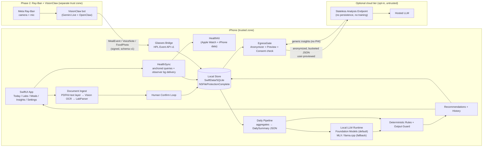
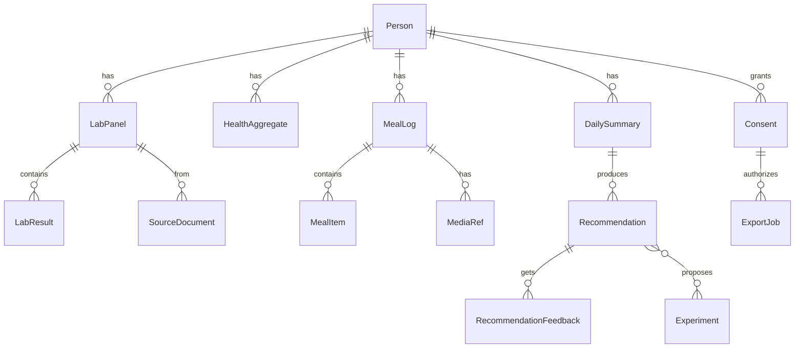
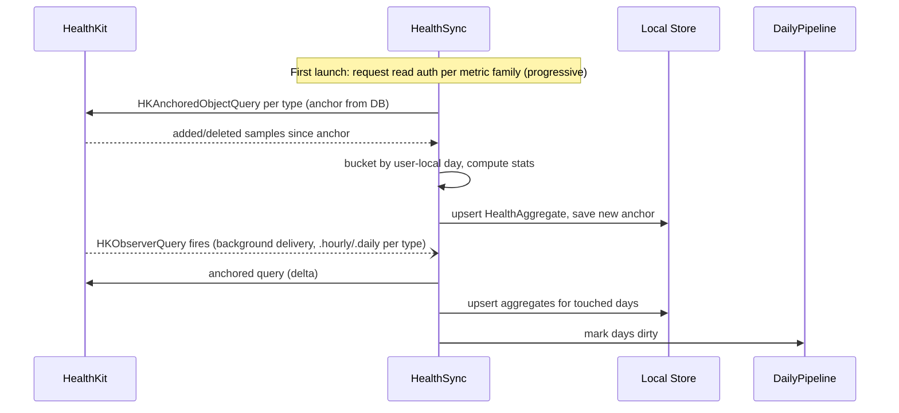
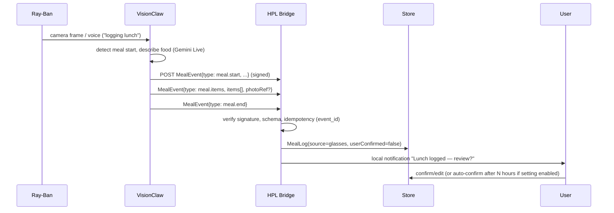
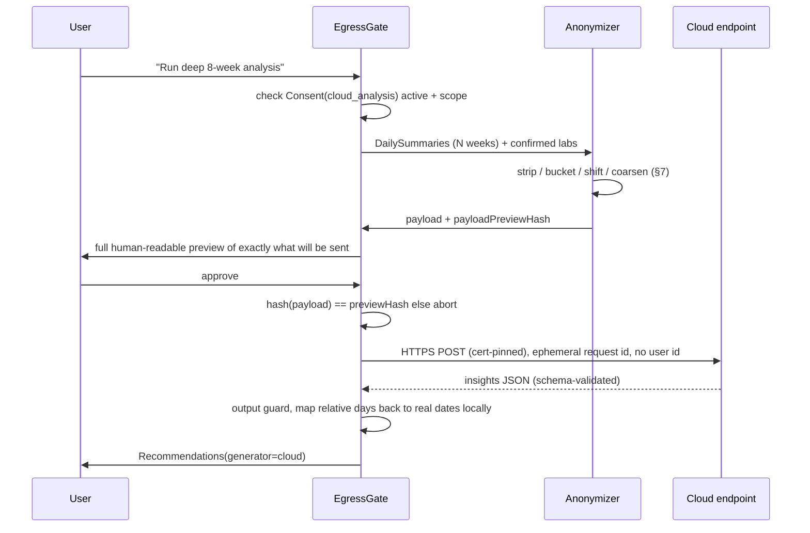

# HeartyPatch Lifestyle: Architecture Document

**Status:** Draft v0.1, for review  
**Owner:** Arash  
**Date:** 2026-10-11  
**Working name:** HeartyPatch Lifestyle ("HPL" below). The name comes from [patchinc/heartypatch](https://github.com/patchinc/heartypatch), a single-lead ECG HRV patch built on an ESP32. The product has since pivoted from custom hardware to Apple Watch + HealthKit + lab data + Ray-Ban glasses. The name can change later; none of the code depends on it.

> **Conventions.** `UNKNOWN` marks things we haven't verified or decided. `DECISION` marks a recommended default that can still be overridden. Anything about Apple, Meta, or regulators that I couldn't confirm against current docs is marked `VERIFY`. Re-check those before building on them.

---

## 1. Executive summary

**What we build.** A local-first iOS app that:

1. Reads Apple Watch / iPhone data from HealthKit (HR, resting HR, HRV, workouts, sleep stages, activity, VO2max, respiratory rate, wrist temperature, and others; full list in §4.3).
2. Ingests blood work and other medical documents (PDF, photo, and FHIR via Health Records where available). It extracts them into structured `LabResult` rows, and the user confirms every extracted value before it is used.
3. Builds a compact, structured **DailySummary** per day on-device.
4. Runs an **on-device LLM** over that summary (never over raw documents) to produce *lifestyle notes* and *personal experiments*, e.g. "On your three nights with dinner after 21:00 this week, deep sleep was ~18% lower. Try a 2-week experiment: dinner before 20:00."
5. Accepts meal and lifestyle events from **Meta Ray-Ban glasses through VisionClaw** ([Intent-Lab/VisionClaw](https://github.com/Intent-Lab/VisionClaw), a real-time voice + vision assistant for Ray-Ban using Gemini Live + OpenClaw) over a narrow, versioned event API. This is Phase 2, but the boundary is designed now.
6. Optionally sends an **anonymized, bucketed, user-previewed** payload to a cloud model for deeper multi-week analysis. Off by default, opt-in per job.

**What we do NOT build:**

- No diagnosis, no treatment, no medication or dosing guidance, no "your lab value means you have X." Out-of-range flags only repeat the reference range printed on the user's own report.
- No backend account system in v1. No server-side storage of health data. No sync service of our own (iCloud is a later, optional decision).
- No third-party analytics or crash SDKs that can see health content.
- No custom hardware (the HeartyPatch ESP32 patch is retired from scope).
- No clinician-facing features and no sharing with providers in v1.
- No HIPAA compliance claims. We are not a covered entity or business associate (§13).

---

## 2. Product principles

| Principle | What it means in code |
|---|---|
| **Local-first** | Source of truth is an on-device encrypted store. The app is fully functional in airplane mode, except the opt-in cloud tier and model download. No login. |
| **Privacy by construction** | The LLM sees a minimal JSON summary, not documents. Cloud sees an anonymized projection of that summary that the user has previewed. Every egress path goes through one `EgressGate` module, which is easy to audit and test. |
| **Non-medical scope** | Output is framed as observations + optional self-experiments. Hard output filters block diagnostic or drug language (§6.6). Persistent disclaimer. Red-flag values return "talk to a clinician," never interpretation. |
| **Progressive disclosure** | Day 1: HealthKit only, useful immediately. Labs, glasses, and cloud are each separate opt-ins with their own consent screen. Each permission is requested at the moment it's needed, not all at onboarding. |
| **User confirms machine extraction** | No OCR'd lab value enters the dataset until a human taps confirm. Confidence is shown. |
| **Explainable** | Every recommendation links to the exact summary fields and days that produced it ("Why am I seeing this?"). |
| **Deletable** | One-tap delete for any record, source, or everything. Export everything as JSON + original files. |

---

## 3. System architecture



**Trust zones.**
- *Phone*: trusted. Raw PHI lives here only.
- *Glasses/VisionClaw*: semi-trusted producer. **Note:** VisionClaw already streams audio/video to Gemini Live (Google cloud) as part of how it works. Anything the glasses see has left the device before HPL receives it. HPL can't fix that; it can only (a) be honest about it in consent copy and (b) accept structured events instead of raw media where possible. See §8.
- *Cloud*: untrusted. Receives only the anonymized projection.

---

## 4. Data model

Store: **SwiftData on top of SQLite** (`DECISION`). The fallback is GRDB if SwiftData migrations or performance hurt; this is a common pain point, so keep the store behind a `Repository` protocol from day one. All timestamps are stored in UTC, along with an IANA `tz` captured at event time. "Day" boundaries use the user's local day, recomputed when they travel.

### 4.1 Entity overview



### 4.2 Entities (Swift-ish, abbreviated)

```swift
// Exactly one row. Never leaves device except in a user-initiated full export.
struct Person {
  id: UUID
  displayName: String?            // optional, local only, never sent to the LLM or cloud
  birthYear: Int?                 // year only; HealthKit DOB reduced to year at read time
  sexForReferenceRanges: Enum?    // from HK biologicalSex if granted; used for ref-range lookup only
  heightCm: Double?, weightKg: Double?  // latest; cloud gets buckets only
  units: Enum (metric|imperial)
  createdAt, updatedAt
}

struct SourceDocument {
  id: UUID
  kind: Enum (pdf|image|fhir|manual)
  fileRef: URL                    // in app container, FileProtection .complete
  sha256: String                  // dedupe
  importedAt: Date
  ocrEngine: String, ocrVersion: String
  rawText: String?                // encrypted at rest; never sent to the LLM
  status: Enum (pending|extracted|confirmed|rejected)
}

struct LabPanel {
  id: UUID
  collectedAt: Date?              // specimen date if found; else user-entered
  labName: String?                // local only; never sent to the cloud
  panelType: String?              // "CMP", "Lipid", "CBC", "HbA1c"... normalized
  sourceDocumentIds: [UUID]
  confirmedAt: Date?
}

struct LabResult {
  id: UUID, panelId: UUID
  analyteRaw: String              // as printed: "Hemoglobin A1c"
  analyteCode: String?            // LOINC if mapped (e.g., "4548-4"); UNKNOWN coverage
  analyteCanonical: String        // internal key: "hba1c"
  valueNumeric: Double?, valueText: String?   // "<0.5", "Negative"
  unitRaw: String, unitCanonical: String      // UCUM where possible
  refLow: Double?, refHigh: Double?, refText: String?  // FROM THE REPORT, not invented
  flagFromReport: Enum? (H|L|HH|LL|A)
  extractionConfidence: Double    // 0–1
  boundingBox: CGRect?, page: Int? // for the confirm UI highlight
  userConfirmed: Bool, userEdited: Bool
}

// Raw HK samples are NOT copied wholesale. Store only per-day/per-window aggregates.
// HealthKit stays the source of truth for raw samples.
struct HealthAggregate {
  id: UUID
  date: LocalDate                 // user-local day
  metric: Enum                    // see 4.3
  window: Enum (day|night|workout|hourly)
  stats: { min, max, mean, median, p10, p90, sum, count, stdev }  // nullable fields
  sourceBundleIds: [String]       // "com.apple.health.<watch>" etc.; local only
  hkAnchor: Data?                 // for incremental recompute
  computedAt: Date
}

struct MealLog {
  id: UUID
  startedAt: Date, endedAt: Date?
  source: Enum (manual|glasses|photo|voice)
  externalEventId: String?        // VisionClaw event id, for idempotency
  description: String?            // free text; LLM sees a sanitized version, cloud never sees it
  items: [MealItem]               // {name, portionEstimate, kcalEst?, proteinG?, carbsG?, fatG?, fiberG?, confidence}
  tags: [String]                  // "late", "alcohol", "high-sugar", "home-cooked" (controlled vocab)
  media: [MediaRef]               // optional, local files, auto-expire by policy
  userConfirmed: Bool
}

struct DailySummary {             // THE contract with the LLM. Versioned JSON.
  id: UUID
  date: LocalDate
  schemaVersion: Int
  json: Data                      // see §6.4
  inputsHash: String              // recompute only when inputs change
  completeness: Double            // fraction of expected signals present
}

struct Recommendation {
  id: UUID
  date: LocalDate
  kind: Enum (observation|experiment|nudge|clinician_prompt)
  title: String, body: String
  evidence: [EvidenceRef]         // {summaryDate, fieldPath, value}; drives "Why am I seeing this?"
  generator: { engine: "fm"|"mlx"|"rules"|"cloud", modelId, promptVersion }
  guardResult: Enum (pass|rewritten|blocked)
  status: Enum (new|accepted|dismissed|snoozed|done)
  createdAt
}

struct Experiment {               // N-of-1 trial
  id: UUID, hypothesis: String, intervention: String
  metric: Enum, baselineDays: Int, interventionDays: Int
  startDate, endDate, result: { baselineMean, interventionMean, note }?
}

struct Consent {
  id: UUID
  scope: Enum (healthkit|labs|glasses|cloud_analysis|media_retention)
  version: String                 // consent copy version, e.g. "cloud-v1"
  grantedAt: Date, revokedAt: Date?
  detail: JSON                    // e.g., which metric families are allowed to egress
}

struct ExportJob {
  id: UUID
  kind: Enum (cloud_analysis|user_export|delete_all)
  consentId: UUID
  payloadPreviewHash: String      // hash of exactly what the user previewed
  payloadSentHash: String?        // must equal preview hash or the send aborts
  destination: String             // endpoint host, or "Files"
  state: Enum (draft|previewed|sent|completed|failed|cancelled)
  createdAt, completedAt
  responseRecommendationIds: [UUID]
}
```

### 4.3 HealthKit types (read-only in v1)

Quantity: `heartRate`, `restingHeartRate`, `walkingHeartRateAverage`, `heartRateVariabilitySDNN`, `heartRateRecoveryOneMinute`, `vo2Max`, `respiratoryRate`, `oxygenSaturation`, `appleSleepingWristTemperature`, `stepCount`, `distanceWalkingRunning`, `activeEnergyBurned`, `basalEnergyBurned`, `appleExerciseTime`, `appleStandTime`, `flightsClimbed`, `bodyMass`, `bodyFatPercentage`, `leanBodyMass`, `height`, `bloodPressureSystolic/Diastolic` (correlation), `bloodGlucose` (CGM users), `dietary*` (if another app writes them), `timeInDaylight`, `environmentalAudioExposure`, `walkingSpeed`, `walkingSteadiness`.  
Category: `sleepAnalysis` (stages: core/deep/REM/awake, iOS 16+), `mindfulSession`, `highHeartRateEvent`, `lowHeartRateEvent`, `irregularHeartRhythmEvent`, `appleStandHour`, `menstrualFlow` & cycle types (separate, sensitive toggle).  
Other: `HKWorkout` + workout routes (route **off** by default, since location is identifying), `HKActivitySummary`, characteristics (`dateOfBirth` reduced to year, `biologicalSex`).  
Clinical records (`HKClinicalTypeIdentifier.labResultRecord`, FHIR): **separate entitlement + App Review justification**, coverage depends on provider. Treat as M2+ stretch. `VERIFY` current entitlement process.

Note: HRV in HealthKit is **SDNN**, sampled sporadically by the Watch. It is not continuous RMSSD as the HeartyPatch ECG patch provided. Summaries must label it `hrv_sdnn_ms` and use overnight/morning medians, not single readings.

Write-back to HealthKit (meals → `dietaryEnergyConsumed` etc.): `UNKNOWN`, deferred to M5. Opt-in only.

---

## 5. Data flows

### 5.1 HealthKit sync



- Backfill: 90 days on first run (configurable), done in chunks in the foreground with progress UI. Then incremental via anchors.
- Use `HKStatisticsCollectionQuery` for cumulative metrics (steps, energy) to avoid double counting Watch + iPhone. **Don't sum raw samples.**
- Sleep: assign a night to the day it *ends* on (wake date). Merge overlapping sources by preferring Watch.
- Background delivery is best-effort. iOS throttles it, and it **does not run while the device is locked with data protection** (HealthKit's store is unavailable when locked). The pipeline must tolerate late data and recompute when the app is opened. `VERIFY` current behavior on iOS 26.
- HealthKit read authorization is opaque: the app can't tell "denied" from "no data". UI must say "No data (or access not granted)" and link to Settings → Health.

### 5.2 Blood-work ingest (PDF / photo)

```mermaid
sequenceDiagram
  participant U as User
  participant UI as Import UI
  participant OCR as Extractor
  participant P as LabParser
  participant C as Confirm UI
  participant DB as Store
  U->>UI: Files picker / Share sheet / VisionKit document camera
  UI->>DB: SourceDocument(pending), file copied to protected container
  UI->>OCR: PDF has text layer? → PDFKit text + positions
  OCR->>OCR: else Vision text recognition (document request on iOS 26+; VNRecognizeTextRequest fallback)
  OCR->>P: lines/tables with bounding boxes
  P->>P: 1) deterministic: regex + analyte dictionary + unit table + ref-range parse
  P->>P: 2) LLM assist (local, guided generation to LabResult schema) only for rows rules couldn't parse
  P->>C: candidate LabResults + confidence + boxes
  C->>U: side-by-side: page image with highlight ↔ editable row
  U->>C: confirm / edit / reject per row, set collection date
  C->>DB: LabPanel + LabResults(userConfirmed=true)
```

Rules:
- **Nothing unconfirmed reaches DailySummary or the LLM.**
- Reference ranges come from the report only. If none is printed, store `refText = nil` and the UI says "no range on report." We don't invent population ranges in v1 (product decision; avoids drifting into interpretation).
- Analyte dictionary v1: ~80 common analytes (CMP, CBC, lipids, HbA1c, fasting glucose, insulin, TSH/free T4, vitamin D, B12, ferritin, iron panel, hs-CRP, ApoB, Lp(a), testosterone, uric acid, eGFR...), with LOINC codes and UCUM unit conversions (e.g., glucose mg/dL ↔ mmol/L × 0.0555; cholesterol mg/dL ↔ mmol/L × 0.02586). Values not in the dictionary go into `analyteRaw` only and are excluded from the LLM unless the user maps them.
- Lab report layouts vary a lot (Quest, Labcorp, international, hospital portals). Expect a long tail. Build a fixture corpus of 30+ **redacted** real reports before M2 exit.
- The PDF may include name/DOB/MRN/address. The parser explicitly discards these fields; they are never stored outside the original file and `rawText`.

### 5.3 Meal logging from glasses (Phase 2)



Details in §8.

### 5.4 Local daily pipeline

Trigger: `BGProcessingTask` (overnight, requires power if possible) + on app foreground if today/yesterday is dirty.

1. Collect dirty days (new aggregates, labs, meals).
2. Build `DailySummary` JSON v1 for each dirty day plus a rolling 7d/28d baseline block.
3. Run **deterministic rules** first (cheap, testable): sleep debt, HRV below personal 28d p10, resting HR above personal baseline +5 bpm for 3+ days, late-meal count, step trend, training load (TRIMP-like from HR zones), lab-confirmed flags (only "your report flagged X; consider discussing with a clinician").
4. Feed summary + rule hits to the local LLM with guided generation into `[RecommendationDraft]`.
5. Output guard (§6.6). Store `Recommendation`s with evidence refs.
6. Post at most **one** notification per day (configurable, default morning).

Budget: < 20 s total on an A17 Pro-class device for one day. The LLM step is the long pole. `UNKNOWN`: real latency numbers to measure in M3.

### 5.5 Anonymization → cloud (opt-in)



---

## 6. On-device ML

### 6.1 Candidates (iOS 26 era, late 2026)

| Runtime | What it is | Pros | Cons |
|---|---|---|---|
| **Apple Foundation Models framework** | System on-device LLM (~3B params, per Apple's 2025 disclosures) exposed via Swift API on Apple Intelligence-capable devices | Zero download, no app-size hit, Apple-managed memory/thermals, **guided generation** (`@Generable` structs), tool calling, Swift-native, private | Only on Apple Intelligence devices (iPhone 15 Pro+ / 16+ and later); user can disable Apple Intelligence; limited context (~4K tokens, `VERIFY` current limit); model changes with OS updates (behavior drift); limited control; safety guardrails may refuse health-adjacent prompts (`UNKNOWN`, test early) |
| **MLX Swift** (`mlx-swift`, `mlx-swift-examples` LLM libs) | Apple's array framework; runs quantized HF models (Qwen, Llama, Gemma, Phi families) on Metal | Choose/pin the model; 4-bit 1–4B models practical; good Apple Silicon perf; can use LoRA adapters | Model download 1–3 GB; memory pressure → jetsam on 6–8 GB phones; we own thermals, sampling, structured output; increased-memory-limit entitlement likely needed |
| **llama.cpp** (Metal, GGUF) | C/C++ inference with Swift bindings | Most portable, mature quantization, grammar-constrained output (GBNF) = reliable JSON, big model ecosystem | C++ bridging; similar download/memory issues; slightly more integration work than MLX |
| **Core ML** (converted LLM, stateful KV cache) | Apple's model format, can hit the Neural Engine | Best power efficiency when it works; ANE offload | Conversion pain for LLMs; fewer ready-made models; slower iteration. Better for **small task models** (food classifier, lab row classifier) than for the main LLM |

### 6.2 Recommendation

- **DECISION — Default: Apple Foundation Models** for lifestyle notes and lab-row extraction assist. The task is short, structured, and summarization-shaped: a small model with guided generation fits well, and shipping zero model weights is a big win for M3 speed.
- **DECISION — Fallback: MLX Swift with a pinned ~3–4B instruct model, 4-bit** (candidate: a Qwen3-4B / Gemma-3-4B-class model, `UNKNOWN` final pick, to be benchmarked). This covers non-Apple-Intelligence devices, users who disabled Apple Intelligence, cases where FM refuses or drifts, and reproducibility (pinned weights). Downloaded on demand over Wi-Fi with checksum verification.
- **Always-on floor: deterministic rules engine.** If no LLM is available, users still get templated observations. The app must never depend on an LLM to be useful.
- Wrap everything behind one protocol so engines can be swapped and A/B'd on a fixture set:

```swift
protocol InsightEngine {
  var id: String { get }
  func isAvailable() async -> Availability
  func generate(summary: DailySummaryV1, ruleHits: [RuleHit], history: [RecSummary]) async throws -> [RecommendationDraft]
  func extractLabRows(_ lines: [OCRLine]) async throws -> [LabRowDraft]
}
```

- Eval harness (M3): 50 synthetic DailySummary fixtures with expected properties (no diagnostic words, references at least one evidence field, ≤ 3 recs, valid JSON, cites correct numbers). Run on every engine/model/prompt change. Track numeric hallucination rate: any number in output must appear in the input.

### 6.3 Small task models (optional, Core ML)

- Food photo → coarse category (phase 2, only if VisionClaw doesn't already supply items).
- Lab-row classifier (is this line an analyte row?) if rules + LLM prove flaky.

### 6.4 What the model sees

The model gets **only** a `DailySummaryV1` JSON. No names, no lab name, no document text, no free-text meal descriptions longer than a sanitized short label, no locations, and no raw sample streams.

```json
{
  "schema": "hpl.daily_summary.v1",
  "day": "D0",
  "day_of_week": "Tue",
  "profile": { "age_band": "35-39", "sex_for_ranges": "M" },
  "sleep": { "total_min": 382, "deep_min": 41, "rem_min": 77, "awake_min": 28,
             "bed_local": "00:41", "wake_local": "07:03",
             "baseline_28d": { "total_min_median": 431, "deep_min_median": 58 } },
  "heart": { "resting_hr": 61, "resting_hr_28d_median": 56,
             "hrv_sdnn_ms_overnight_median": 38, "hrv_28d_p10": 40, "hrv_28d_median": 52 },
  "activity": { "steps": 4210, "steps_28d_median": 8900, "active_kcal": 310,
                "exercise_min": 12, "stand_hours": 8 },
  "workouts": [ { "type": "running", "duration_min": 32, "avg_hr": 151, "zone_minutes": [0,4,12,14,2] } ],
  "meals": [ { "t_local": "13:10", "label": "lunch", "tags": ["home-cooked"] },
             { "t_local": "21:45", "label": "dinner", "tags": ["late", "alcohol"] } ],
  "labs_recent": [ { "analyte": "hba1c", "value": 5.6, "unit": "%",
                     "ref_low": null, "ref_high": 5.6, "report_flag": null, "age_days": 41 } ],
  "rule_hits": ["SLEEP_SHORT_VS_BASELINE", "HRV_BELOW_P10", "LATE_MEAL_ALCOHOL"],
  "active_experiments": [ { "id": "E1", "intervention": "dinner before 20:00", "day": 4, "of": 14 } ],
  "completeness": 0.92
}
```

Approx. 600–900 tokens, which fits the FM context with room for instructions and output. Weekly runs use a pre-reduced 7-day table, not 7 full summaries.

### 6.5 Prompt contract (sketch)

System: "You are a lifestyle coach that writes observations and optional self-experiments from structured data. You do not diagnose, name diseases, suggest medications, supplements doses, or interpret lab values beyond restating the report's own range and flag. Every claim must cite a field from the input. Max 3 items. If a rule hit is `CLINICIAN_PROMPT_*`, output exactly the provided clinician-prompt template."  
Output: guided generation into `[RecommendationDraft{kind,title,body,evidenceFieldPaths[]}]`.

### 6.6 Output guard (deterministic, post-LLM)

- Blocklist / regex: disease names (curated list), "diagnos*", "you have", "deficien*" as a conclusion, drug/supplement names + dosages (mg/IU), "stop taking", "treat", "cure".
- Number check: every number in `body` must exist in the input (± rounding), else rewrite with a template or drop.
- Evidence check: `evidenceFieldPaths` must resolve.
- Red-flag passthrough: values printed as critical on the report (HH/LL), or HealthKit `irregularHeartRhythmEvent` → fixed, pre-written copy: "Your report/watch flagged this. Consider contacting a clinician." The LLM doesn't get to write this text.
- Log `guardResult` locally for eval; never upload.

---

## 7. Anonymization design

Goal: a cloud model can reason about *patterns* without being able to identify the person or recover rare identifying facts. Assume the cloud provider is honest-but-curious and that payloads might leak.

### 7.1 Transformations

| Field class | Treatment |
|---|---|
| Name, email, phone, address, MRN, DOB, lab/provider name, device name, HK source bundle ids, Apple ID | **Dropped.** Never in the payload; enforced by schema allowlist (anything not allowlisted is dropped) |
| Free text (meal descriptions, voice notes, report text, user notes) | **Dropped** by default. Only controlled-vocabulary tags (`late`, `alcohol`, `high-protein`...) pass |
| Dates | Converted to **relative day indices** (`D-55 … D0`) with a random per-job offset discarded after the job; day-of-week kept (useful, low risk). No absolute dates. Mapping back happens only on device |
| Times of day | Rounded to 30 min |
| Age | 5-year band; ≥ 80 → "80+" |
| Height/weight | BMI band (e.g., 22.5–25) or weight 5 kg buckets; no height |
| Location / workout routes | Never sent |
| Common labs (in dictionary, "common" flag) | Value rounded to clinically meaningless precision (e.g., LDL to nearest 5 mg/dL, HbA1c 0.1%), unit canonicalized, `age_days` bucketed (0–30, 31–90, 91–180, 180+) |
| Rare / identifying labs (genetic markers, rare disease panels, tumor markers, HIV/STI, pregnancy, drug screens, Lp(a) extreme tails, anything not in the dictionary) | **Not sent** by default. Allowed only as a coarse category ("within report range" / "outside report range") if the user explicitly toggles that analyte |
| Extreme values (any metric beyond population p1/p99, static table) | Clamped to the bucket edge ("> p99") |
| Workouts | Type from a common-type allowlist (running, cycling, strength, walking, yoga, other); durations rounded to 5 min |
| Reproductive health, mental health tags | Off by default; separate toggle |
| Request metadata | No user id, no device id. Per-request random UUID. Optional App Attest assertion proves "genuine app," not "which user" (§10) |

### 7.2 Aggregation rules

- Minimum window: **28 days**. Single-day payloads are not allowed (too fingerprintable, little analytic value).
- Prefer **weekly aggregates** (median/p10/p90 per metric per week) over daily rows. Daily rows are allowed only for ≤ 12 core metrics.
- Payload length cap (e.g., 8 KB) to bound leakage.

### 7.3 Formal privacy notes (high level, honest)

- **k-anonymity** is a *design heuristic* here, not a guarantee. There's no population dataset on the client to compute k against. We approximate it with coarse buckets chosen so that each quasi-identifier combination (age band × sex × BMI band) is broad in general population terms. Longitudinal time series are still inherently fingerprintable, so we rely on (a) minimization, (b) no stable identifiers, and (c) a no-retention contract with the provider.
- **Differential privacy:** local DP (Laplace noise on aggregates) is possible but would hurt individual-level insight quality, which is the whole point. `DECISION`: no DP noise on the per-user analysis payload in v1. DP *does* apply if we ever collect product telemetry across users (counts of feature usage, with noise via a standard local-DP mechanism), and that telemetry contains no health content regardless.
- Re-identification risk is **not zero**. Consent copy must say so plainly: "We remove identifiers and coarsen values. A determined party with other data about you could still potentially link it. Only use this if you're comfortable with that."

### 7.4 Enforcement

- `Anonymizer` is a pure function `(LocalData, Policy) -> CloudPayloadV1` with exhaustive unit tests + a property test: no string in the output may match any string in `Person`, `SourceDocument.rawText`, `LabPanel.labName`, or `MealLog.description`.
- `EgressGate` is the **only** code allowed to touch `URLSession` for health-derived data. Enforced by a lint rule / module boundary (`HPLCloud` target is the only one linking networking for payloads).
- Preview hash == sent hash, or abort.

---

## 8. Ray-Ban / VisionClaw integration

### 8.1 Boundary

VisionClaw owns: the glasses connection, the camera/mic stream, Gemini Live conversation, meal detection, and food description. HPL owns: validation, storage, confirmation, and health context. **HPL never talks to the glasses directly in Phase 2.** If we later want direct capture, Meta's Wearables Device Access Toolkit for iOS is the path (`VERIFY` current availability/terms; it was in developer preview as of late 2025).

### 8.2 Event API v1

Envelope:
```json
{
  "spec": "hpl.event.v1",
  "event_id": "01J…ULID",
  "type": "meal.start",
  "occurred_at": "2026-10-11T19:42:10Z",
  "tz": "America/Los_Angeles",
  "producer": { "name": "visionclaw", "version": "x.y.z" },
  "session_id": "meal-session ULID",
  "payload": { }
}
```

| `type` | Payload | Notes |
|---|---|---|
| `meal.start` | `{ trigger: "voice"|"vision"|"manual" }` | Opens a session |
| `meal.items` | `{ items: [{name, portion_text?, kcal_est?, protein_g?, carbs_g?, fat_g?, fiber_g?, confidence}], tags?: [] }` | Can repeat; merged by session |
| `meal.photo` | `{ photo_ref, sha256, width, height }` | Media is optional and off by default (§8.4) |
| `meal.end` | `{ }` | Closes the session; HPL auto-closes after 90 min |
| `voice.note` | `{ text, intent?: "craving"|"mood"|"energy"|"symptom"|"other" }` | Text only, no audio. `symptom` is stored but never interpreted |
| `lifestyle.event` | `{ kind: "caffeine"|"alcohol"|"water"|"sunlight"|"screen_late"|"custom", amount?, unit? }` | Controlled vocab |
| `ping` | `{ }` | Health check |

- Idempotent on `event_id`. Unknown `type` → stored as `ignored` and logged; HPL doesn't fail on it.
- Signature: HMAC-SHA256 over the canonical body with a per-pairing secret (32 bytes, exchanged once via QR code shown in HPL, stored in Keychain on the phone). `X-HPL-Signature`, `X-HPL-Timestamp`; reject if clock skew > 5 min.
- A JSON Schema file lives in a shared spec repo/folder so both sides can contract-test.

### 8.3 Transport options

| Option | How | Pros | Cons |
|---|---|---|---|
| **A. Shared inbox (DECISION for Phase 2a)** | VisionClaw writes `.hplevent.json` files (or a batched `.jsonl`) to an iCloud Drive / Files folder, or emails/shares them; HPL imports on foreground and via a Files folder watcher, or the user taps "Import" | Dead simple, no networking, works offline, no background-exec issues, easy to debug | Latency (minutes–hours), requires both apps to use the same storage; iCloud is Apple's cloud (encrypted, but still a cloud) |
| **B. Local network HTTP** | HPL runs a tiny listener (Network.framework, Bonjour `_hpl._tcp`) while foregrounded; VisionClaw POSTs | Real-time when open | iOS suspends listeners in the background, so it **won't work as "always-on"** unless HPL is foreground; local network permission prompt |
| **C. Same-device handoff** | If VisionClaw runs on the same iPhone: App Group container (requires same developer team) or URL scheme / App Intents (`hpl://event?...`) / Shortcuts | Instant, no network | App Group only if both apps ship under Arash's team; URL scheme payload limits; app switching |
| **D. Relay** | VisionClaw → small relay (e.g., the OpenClaw host) → APNs silent push → HPL fetches | Near real-time, works in background | Adds a server holding health-adjacent data, which breaks local-first; only E2E-encrypted blobs could be acceptable |

`DECISION`: Ship **A** first (with a "Share to HPL" action), add **C (App Intents)** if VisionClaw has an iOS component on the same phone. Evaluate **D** with E2E encryption only if real-time matters. `UNKNOWN`: where VisionClaw's process actually runs (phone app vs. Mac/server host for OpenClaw). This drives the choice; confirm with Arash.

### 8.4 Privacy for glasses

- VisionClaw → Gemini Live already means frames/audio are processed in Google's cloud. HPL's consent screen for glasses states this explicitly and links to VisionClaw's settings. HPL does not add another cloud hop.
- Default: VisionClaw sends **structured items only, no photos**. If photos are enabled: stored locally, File Protection complete, auto-deleted after 7 days (configurable), never sent to cloud analysis.
- Bystanders: the glasses can capture other people. Ask VisionClaw to crop/describe food only. HPL rejects photos above a size cap and runs on-device face detection (Vision), dropping any photo containing faces (`DECISION`; cheap and defensible).
- "Always-on" is VisionClaw's concern. HPL should show a clear indicator of the last event received and a one-tap "pause glasses logging" that rejects events until resumed.

---

## 9. iOS app structure

### 9.1 Targets / Swift packages

```
HeartyPatchLifestyle.xcworkspace
├─ App/                      (SwiftUI app target, iOS 26 min — DECISION, see open decisions)
├─ Packages/
│  ├─ HPLCore                Models, Repository protocols, units, LocalDate, errors
│  ├─ HPLStore               SwiftData/GRDB implementation, migrations, FileProtection
│  ├─ HPLHealth              HealthKit auth, anchored queries, observer + bg delivery, aggregators
│  ├─ HPLIngest              PDFKit/Vision OCR, LabParser, analyte dictionary (JSON resource), UCUM
│  ├─ HPLPipeline            DailySummary builder, rules engine, BGTask scheduling
│  ├─ HPLInference           InsightEngine protocol, FoundationModelsEngine, MLXEngine, RulesOnlyEngine, OutputGuard
│  ├─ HPLBridge              Event API v1 schema, HMAC verify, inbox importer, App Intents
│  ├─ HPLCloud               Anonymizer, EgressGate, cloud client (ONLY networking for health data)
│  └─ HPLUI                  Shared components, disclaimer banner, charts (Swift Charts)
├─ Fixtures/                 redacted lab PDFs, synthetic HK exports, DailySummary fixtures
└─ Spec/                     hpl.event.v1.schema.json, hpl.daily_summary.v1.schema.json, cloud payload schema
```

### 9.2 Screens

- **Onboarding:** what it is / isn't (disclaimer, must acknowledge) → HealthKit connect (metric families, progressive) → done. Labs/glasses/cloud are offered later as cards.
- **Today:** sleep, HRV/RHR vs baseline, activity, meals, up to 3 recommendations, active experiment progress.
- **Labs:** panels over time, per-analyte trend chart with the report's own ranges, import button, pending confirmations.
- **Meals:** timeline, glasses-sourced items awaiting confirmation, manual add.
- **Insights:** recommendation history, filters, accepted/dismissed, experiments + results.
- **Settings:** data sources, consents (view/revoke each, with version), model engine (Auto / Apple / Downloaded model / Rules only), notification time, glasses pairing + pause, cloud analysis (off by default), export all, delete all, disclaimers, about.

### 9.3 Entitlements & Info.plist

- `com.apple.developer.healthkit` (+ `healthkit.access` empty unless clinical records → `health-records`)
- `com.apple.developer.healthkit.background-delivery`
- `NSHealthShareUsageDescription` (specific: "Read sleep, heart, and activity data to build daily summaries on your device"). `NSHealthUpdateUsageDescription` only if write-back ships. `NSHealthClinicalHealthRecordsShareUsageDescription` if clinical records.
- `NSCameraUsageDescription` (document scanning), `NSLocalNetworkUsageDescription` + `NSBonjourServices` (transport B only)
- `BGTaskSchedulerPermittedIdentifiers`: `com.hpl.daily-pipeline`, `com.hpl.model-maintenance`
- `com.apple.developer.kernel.increased-memory-limit` (MLX fallback); `VERIFY` whether needed on target devices
- Data Protection entitlement: `NSFileProtectionComplete` as default
- App Attest (`com.apple.developer.devicecheck.appattest-environment`) only if cloud tier ships
- App Groups only if same-team VisionClaw handoff

### 9.4 Background work

- HKObserverQuery + `enableBackgroundDelivery` per type (sleep: `.immediate` isn't meaningful; use `.hourly`; steps: `.hourly`; workouts: `.immediate`).
- `BGProcessingTask` for the daily pipeline (requiresExternalPower: false, but prefer charging window). `BGAppRefreshTask` for inbox import.
- Everything is idempotent and recomputable; background is an optimization, not a requirement.

### 9.5 File import

- `.fileImporter` (PDF, images, `.hplevent.json`), Share Extension ("Share to HPL" from Mail/Files/Photos/portal apps), VisionKit `VNDocumentCameraViewController`. The Share Extension writes to an App Group inbox; the main app processes it. The extension does no parsing (memory limits).

---

## 10. Security

- **At rest:** all app files and the DB use `NSFileProtectionComplete`. Background tasks that need DB access while locked must be designed around this: either use `CompleteUntilFirstUserAuthentication` for a *separate* small "pending work" queue holding no PHI, or defer work until unlock. `DECISION`: defer; the DB stays `Complete`.
- **Keychain:** glasses pairing secret, cloud request signing material, optional DB encryption key (`kSecAttrAccessibleWhenUnlockedThisDeviceOnly`, non-synchronizable). If we add SQLCipher (`UNKNOWN`, probably unnecessary on top of iOS Data Protection), its key lives here.
- **App lock:** optional Face ID / passcode gate (LocalAuthentication) on open; blur in the app switcher.
- **Backups:** iCloud/Finder backups include app data (encrypted backups protect it). Offer a "exclude from backup" toggle (`isExcludedFromBackup`); `UNKNOWN` default. Tradeoff: losing data on a new phone vs. backup exposure.
- **Network:** only `HPLCloud` sends health-derived data. ATS on, TLS 1.3, certificate/public-key pinning to the cloud endpoint. Model downloads verify SHA-256 against a manifest bundled in the app binary.
- **App Attest (optional):** cloud endpoint requires a valid attestation/assertion to limit abuse and cost. It doesn't identify users; the key id is rotated per install and not linked to payloads server-side (don't log it next to the payload).
- **No analytics of health content by default.** No third-party SDKs with network access in v1. Crash reporting: Apple's built-in (MetricKit / App Store Connect) only. Logs use `os.Logger` with `privacy: .private` for every dynamic value. No health values in logs, ever, enforced by a lint/grep check in CI.
- **Supply chain:** pin SPM dependency versions, minimal deps (MLX, possibly GRDB). Review licenses of any bundled/downloaded model weights.
- **Delete:** "Delete all" wipes DB, files, Keychain items, model cache, and resets HK anchors. HealthKit data itself is untouched (it isn't ours).

---

## 11. Milestones

| # | Scope | Exit criteria |
|---|---|---|
| **M0** | Repo, Xcode workspace + packages skeleton (§9.1), CI (build + unit tests on simulator), SwiftLint, disclaimers text v1, empty SwiftUI shell with tabs, onboarding disclaimer acknowledgement persisted | Fresh clone builds on CI; app launches to tabs; disclaimer must be acknowledged once and is visible in Settings; `Spec/` contains draft schemas; README states non-medical scope |
| **M1** | HealthKit read (metric families in §4.3 minus clinical), anchored backfill 90d, observer + background delivery, HealthAggregate per day, Today screen with sleep/HR/HRV/activity vs 28d baseline | On a real device with ≥ 30 days of Watch data: aggregates match Health app values (steps within 1%, sleep total within 5 min) for 7 spot-checked days; incremental sync after a new workout appears without relaunch (or on next foreground); denied permissions show correct empty states; no PHI in logs (CI grep) |
| **M2** | Lab ingest: file importer, document camera, share extension, PDFKit + Vision OCR, LabParser (rules + analyte dictionary ~80 + unit conversion), human confirm UI with highlights, Labs screen + trends | On a fixture corpus of ≥ 30 redacted reports from ≥ 5 lab formats: ≥ 90% of in-dictionary analyte rows extracted with correct value+unit before human edit; 0 unconfirmed values reach the store's "confirmed" set (test); identifiers (name/DOB/MRN) never appear in LabPanel/LabResult (property test); re-importing the same file dedupes |
| **M3** | DailySummary v1 builder, rules engine (≥ 10 rules), InsightEngine protocol, Foundation Models engine with guided generation, RulesOnly engine, OutputGuard, eval harness | On 50 fixtures: 100% schema-valid output, 0 guard-blocklist hits in final output, ≥ 95% of numeric claims traceable to input, ≤ 3 recs/day; median generation latency measured and recorded for 2 devices; app degrades to rules-only when FM unavailable (tested via availability mock) |
| **M4** | Recommendation UI: Today cards, "Why am I seeing this?" evidence view, accept/dismiss/snooze, feedback, history screen, experiments (N-of-1 start/track/result), one daily notification | A user can start a 14-day experiment from a recommendation, see progress daily, and get a baseline-vs-intervention result; history persists across launches and is exportable as JSON; dismissed rec kinds are de-prioritized in following days |
| **M5** | Glasses bridge: Event API v1 + JSON Schema, HMAC pairing via QR, inbox importer (transport A), App Intent (C) if applicable, meal confirm UI, pause toggle, photo policy + face filter; matching changes on the VisionClaw side | End-to-end: a meal spoken/seen on Ray-Ban → VisionClaw → appears as pending MealLog in HPL within transport's expected latency; duplicate events ignored; invalid signature rejected; photos with faces dropped; meals appear in DailySummary `meals[]` after confirm |
| **M6** | Cloud tier (opt-in): consent v1, Anonymizer + policy, preview screen, EgressGate with hash check, stateless endpoint (no persistence), App Attest optional, response guard | Property tests pass (no identifier leakage across 1,000 randomized profiles); preview == sent byte-for-byte; endpoint logs contain no payload bodies (verified in config); revoking consent blocks the next job; the feature is unreachable without explicit opt-in |
| **M7** | Polish: accessibility (Dynamic Type, VoiceOver on charts), empty/error states, performance (cold start < 1.5 s), privacy nutrition label, App Store copy reviewed for claims, TestFlight external build, export/delete-all verified | TestFlight build approved for external testing; App Privacy details filled accurately; 10 testers × 2 weeks with no P0 bugs; delete-all verified to leave no files/Keychain items; written review of all user-facing copy against §13 |

---

## 12. Open decisions

| Decision | Options | Recommendation | Needed by | Status |
|---|---|---|---|---|
| Minimum iOS version | iOS 26 only / iOS 18 + rules-only fallback | iOS 26 (Foundation Models, newer Vision document APIs); revisit if testers are on older devices | M0 | Proposed |
| Primary LLM | Apple Foundation Models / MLX model / llama.cpp model | FM default, MLX fallback | M3 | Proposed. `UNKNOWN`: FM refusal rate on health-adjacent prompts |
| Fallback model pick | Qwen3-4B-class / Gemma-3-4B-class / Llama-3.2-3B-class, 4-bit | Benchmark on eval harness for quality + memory + license | M3 | Open |
| Persistence | SwiftData / GRDB / Core Data | SwiftData behind Repository; GRDB if pain | M1 | Proposed |
| Lab OCR | On-device (PDFKit + Vision + rules + local LLM) / cloud vendor (AWS Textract, Google Document AI, Azure Document Intelligence) | On-device. A vendor means sending documents with full identifiers to a cloud, which contradicts the product. Revisit only for user-initiated, redacted uploads if accuracy fails M2 exit | M2 | Proposed |
| Clinical records (FHIR via HealthKit) | Include in M2 / later | Later (stretch), extra entitlement + review | M2+ | Open |
| Cloud provider for M6 | Self-hosted open model on own GPU box / API LLM provider with zero-retention terms / Apple Private Cloud Compute (`UNKNOWN` whether third-party apps can use it) | Zero-retention API provider behind a thin stateless proxy we control; confirm contractual no-training/no-retention | M6 | Open |
| Ray-Ban transport | Shared inbox / local HTTP / App Intents / E2E relay | Inbox first, App Intents if same-device | M5 | Open. Depends on where VisionClaw runs (`UNKNOWN`) |
| Glasses photos | Never / opt-in local with TTL | Opt-in, 7-day TTL, face filter | M5 | Proposed |
| HealthKit write-back of meals | Yes / no | No until M5 review | M5 | Open |
| iCloud sync of HPL store | None / CloudKit private DB (E2E for some types) | None in v1 | Post-M7 | Proposed |
| Backup exclusion default | Included / excluded | Included (data loss is the bigger user pain); toggle available | M7 | Open |
| Product name | HeartyPatch Lifestyle / other | Keep working name; trademark check before App Store | M7 | Open |

---

## 13. Risks & compliance notes

*Not legal advice. Get a short review from a health-tech/privacy lawyer before external TestFlight (M7).*

**HIPAA.** Not assumed to apply. HIPAA covers covered entities (providers, plans, clearinghouses) and their business associates. A direct-to-consumer app the user installs themselves usually falls outside it. Don't claim "HIPAA compliant" anywhere; that claim invites scrutiny and is meaningless here. If we ever integrate *on behalf of* a provider or employer, revisit.

**What does apply (likely):**
- **FTC Health Breach Notification Rule** (amended 2024) applies to non-HIPAA health apps. An unauthorized disclosure (including sharing with analytics/ads without authorization) counts as a "breach." Our no-third-party-SDK stance is the main mitigation. `VERIFY` current text.
- **FTC Act §5** (deceptive claims), e.g. "anonymous" must be true in the way users would understand it. Use "de-identified and coarsened," not "fully anonymous."
- **State consumer health data laws:** Washington My Health My Data Act (private right of action, broad definition of consumer health data, consent for collection *and* sharing), Nevada's similar law, California CCPA/CPRA sensitive data + CMIA. Local-only processing helps a lot; the cloud tier needs explicit, separate consent and a privacy policy that matches reality. `VERIFY` before launch.
- **GDPR** (if EU users): health data is special-category, so explicit consent is required for the cloud tier. Consider geofencing v1 to the US via App Store availability.

**FDA / wellness framing.** Stay within FDA's *general wellness* policy: low-risk products intended to maintain/encourage a healthy lifestyle, with no claims about diagnosing, treating, mitigating, or preventing specific diseases. Also watch the **Clinical Decision Support** guidance if lab interpretation creeps in. `VERIFY` latest versions of both guidances (FDA has revised them; check the current text, don't rely on memory).
Concretely:
- ✅ "Your sleep was shorter than your 4-week typical; try an earlier wind-down for 2 weeks."
- ✅ "Your report marks LDL as above its range. Consider discussing with your clinician."
- ❌ "Your LDL suggests cardiovascular risk." ❌ "You may be prediabetic." ❌ "Take 2000 IU vitamin D." ❌ "Your HRV pattern indicates AFib."
- Irregular rhythm notifications from Apple Watch are FDA-cleared Apple features. We only surface that the event occurred, with clinician-prompt copy.

**App Store.** Guideline 1.4.1 (medical apps: scrutiny of claims, accuracy, disclose methodology), 5.1.1 (privacy/consent), 5.1.3 (health data: no advertising/marketing use, no storing personal health info in iCloud, no false data into HealthKit, privacy policy required). App description and screenshots must use wellness language. `VERIFY` current guideline numbering/text at submission time.

**Disclaimers (v1 text, in onboarding + Settings + footer of every recommendation detail):**
> HeartyPatch Lifestyle provides general wellness information and self-experiment ideas based on data you choose to share with it. It is not a medical device and does not diagnose, treat, cure, or prevent any disease or provide medical advice. Lab values are shown as printed on your report; we do not interpret them. Talk to a qualified clinician about any health concern or before changing medications, diet, or exercise in significant ways. If you think you may have a medical emergency, call your local emergency number.

**Product/engineering risks:**

| Risk | Impact | Mitigation |
|---|---|---|
| LLM hallucinates numbers / drifts into medical language | Trust, regulatory | Structured input, guided output, numeric trace check, blocklist guard, eval harness in CI |
| Foundation Models refuses health prompts or changes behavior with iOS updates | Feature breaks silently | Engine abstraction, MLX fallback, rules floor, eval on every iOS beta |
| Lab parsing long tail | Bad data in | Human confirm required; fixture corpus; manual entry path |
| HealthKit background delivery is unreliable | Stale insights | Recompute on foreground; show "updated at" |
| MLX model memory → jetsam | Crashes | Size cap (≤ 4B, 4-bit), memory entitlement, unload after use, rules fallback |
| Re-identification from cloud payload | Privacy harm, FTC exposure | Minimization, buckets, 28d min, no ids, preview, honest consent copy |
| VisionClaw/Gemini privacy posture differs from HPL | User confusion | Explicit consent copy; structured events only by default |
| Bystander capture from glasses | Legal/ethical | Face filter drop, no photo default, TTL |
| Scope creep into diagnosis ("just tell me what my labs mean") | Regulatory | Product rule: we restate, never interpret; clinician prompt |

---

## 14. Immediate next coding step (after approval)

**M0, day 1, in this order:**

1. Create repo `heartypatch-lifestyle-ios` with the workspace + 9 local Swift packages from §9.1 (empty but compiling), `App` target iOS 26, SwiftLint, GitHub Actions running `xcodebuild test` on an iPhone simulator.
2. Add `Spec/hpl.daily_summary.v1.schema.json` and `Spec/hpl.event.v1.schema.json` (from §6.4 / §8.2) plus `HPLCore` Codable types that round-trip the example JSON in a unit test. This locks the two contracts everything else hangs on.
3. SwiftUI shell: TabView (Today / Labs / Meals / Insights / Settings) with placeholder views, onboarding disclaimer screen with acknowledgement persisted (`Consent(scope: .disclaimer, version: "v1")`), disclaimer visible in Settings.
4. Add the `InsightEngine` protocol + `RulesOnlyEngine` stub returning one templated recommendation from a fixture DailySummary, shown on Today. This proves the end-to-end path (fixture → engine → guard → UI) before HealthKit exists.
5. CI check: grep that fails the build if `print(` or non-`.private` `Logger` interpolation appears in `HPLHealth`, `HPLIngest`, `HPLStore`, `HPLCloud`.

Then M1 starts with `HPLHealth` authorization for sleep + heart + activity families and the anchored-query aggregator for steps and sleep, validated against the Health app on a real device.

**Questions for Arash before/while M0 runs:**
1. Where does VisionClaw run: an iOS app on the same phone, a Mac, or a server host? (Drives §8.3.)
2. OK with iOS 26 minimum / Apple Intelligence devices as the primary target?
3. Is the cloud tier a must-have for v1, or fine as post-TestFlight?
4. Do you have 10–30 of your own (redactable) lab reports for the M2 fixture corpus?
